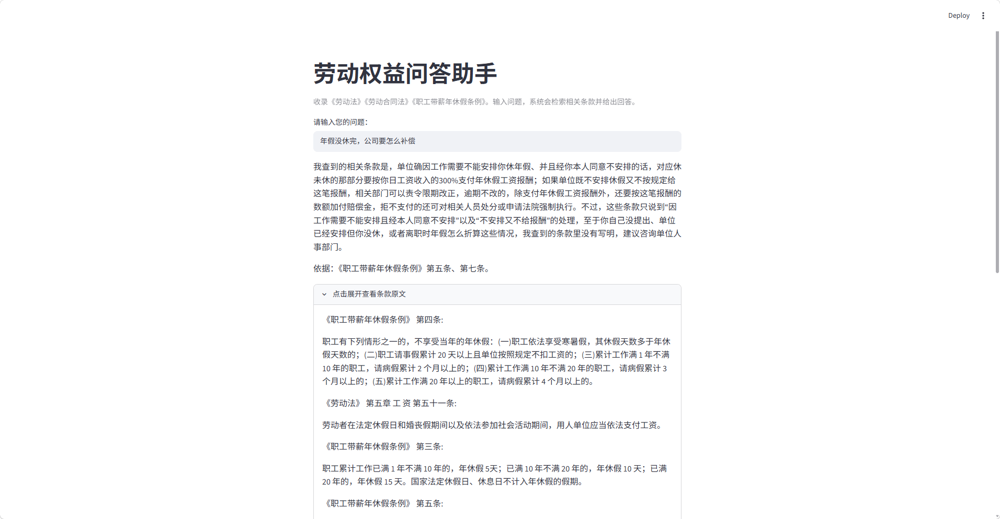

# rag-qa · 劳动权益问答助手

用大白话问打工人常碰到的劳动问题（年假、加班、试用期、劳动仲裁……），系统会先从法条中检索出最相关的条款，再让大模型**只根据这些条款**作答，并标出依据的是哪部法的哪一条。

🌐 **在线体验**：<https://modelscope.cn/studios/wyh0410/law_assistance>（部署在魔搭 ModelScope 创空间，国内可直接打开，无需安装）

收录三部法规，共 215 条：《中华人民共和国劳动法》（107 条）、《中华人民共和国劳动合同法》（98 条）、《职工带薪年休假条例》（10 条）。

> A retrieval-augmented QA app over three PRC labor statutes (215 articles, 331 retrieval chunks): Chinese embeddings + Chroma for retrieval, enumerated articles split into item-level chunks (small-to-big retrieval with per-article dedupe), an LLM constrained to answer only from the retrieved articles with law-and-article citations, evaluated with Recall@k on 18 annotated questions.



## 它是怎么工作的

```
用户提问 "怎么请年假？"
   │
   ├─ ① 检索：问题转成向量（中文 embedding 模型）→ 在 Chroma 里按余弦相似度取回最相近的 50 块
   │       → 同一条法条只保留排得最靠前的一块，凑够 8 条不同的法条（三部法在同一个库里一起搜）
   │
   ├─ ② 拼 prompt：交给模型的是这 8 条的**整条原文**（不是命中的那一小块），每条贴上「法名 + 章 + 节 + 条号」标签，加上回答规则
   │       · 只根据给出的条款回答，不使用模型自己的知识
   │       · 条款只能回答一部分时，说出能回答的，也说出没写到的
   │       · 完全不相关时，明确说没有找到
   │
   └─ ③ 生成：调用 DeepSeek 生成口语化的回答，最后一行写出依据（如"依据：《职工带薪年休假条例》第三条"）
```

离线准备（只做一次）：三份 PDF → 清洗页码 → 按"条"切成 215 条 → 带"（一）（二）……"清单的条再按项拆开，每项前面带上总起句，共 331 块（每块带法名、章、节、条号和整条原文）→ 向量化后存入 Chroma。

## 效果

### 1. 中文 embedding 模型 vs 默认英文模型

（只收录《劳动法》时测的）同一个问题"怎么请年假？"，正确答案是第四十五条（带薪年休假）：

| embedding 模型 | 第四十五条排名 | 前几名是什么 |
|---|---|---|
| Chroma 默认（all-MiniLM-L6-v2，英文） | 第 7 / 107 | 前 3 名都是第七章"女职工特殊保护"（产假相关） |
| text2vec-base-chinese（本项目） | **第 3 / 107** | 前 5 名都是休息休假相关条款 |

英文模型排出的结果更像是在匹配相同的汉字（"年**假**" / "产**假**"），中文模型才是在匹配意思。

### 2. 检索召回率 Recall@k：加了文档，k 要重新定

5 个问题（年假、劳动仲裁及时限、每日工作时长、试用期、加班费），每题人工标注"直接回答了这个问题"的条款。

| k | 1 | 2 | 3 | 4 | 5 | 6 | 7 | 8 |
|---|---|---|---|---|---|---|---|---|
| 只有《劳动法》（107 条，7 条标准答案） | 2/7 | 3/7 | 6/7 | **7/7** | 7/7 | 7/7 | 7/7 | 7/7 |
| 三部法（215 条，11 条标准答案） | 2/11 | 4/11 | 7/11 | 7/11 | 7/11 | 8/11 | 9/11 | **11/11** |

只有《劳动法》时 k=4 召回率就到顶，当时取 k=5。加入另外两部法以后，k=5 只剩 7/11，要到 **k=8** 才全部找到，所以现在默认取 k=8。

最能说明问题的是"加班费怎么算？"：题目和标准答案（劳动法第四十四条）都没变，以前 k=4 就能找到，现在要 k=6。库里的条款多了一倍，《劳动合同法》里也有不少讲加班和工资报酬的条款，把它挤到了后面。**文档越多，同一个 k 召回得越少，每加一批数据都要重新测 k。**

### 3. 扩大评测集，按名次找问题，再改切块

评测集扩到 18 个问题、31 条标准答案（新增签合同、辞退补偿、辞职通知期、试用期工资、拖欠工资、孕期辞退、违法辞退赔偿、劳务派遣、竞业限制、年假补偿、最低工资）。评测脚本除了 Recall@k，还会报告**每条标准答案排第几名**。

| k | 5 | 8 | 10 | 15 | 20 | 30 |
|---|---|---|---|---|---|---|
| 按条切（215 块） | 21/31 | 26/31 | 26/31 | 27/31 | 28/31 | 29/31 |
| 按项拆 + 检索去重（331 块） | **23/31** | **27/31** | **29/31** | **30/31** | **30/31** | **30/31** |

按条切时，k 从 8 加到 30 只多找回 3 条，说明问题不在 k，而在检索本身。名次最差的两条都是"有下列情形之一的……（一）……（二）……"这种长清单：

| 问题 | 标准答案 | 按条切 | 按项拆 |
|---|---|---|---|
| 被公司辞退有没有经济补偿？ | 劳动合同法第四十六条（七项情形） | 第 66 名 | **第 3 名** |
| 公司拖欠工资怎么办？ | 劳动合同法第三十八条（六项 + 一段） | 第 72 名 | **第 7 名以内** |

用户问的只是其中一项，整条的向量被其余几项"稀释"了。按项拆开以后，相关的那一项单独和问题比，距离明显变近（第四十六条：0.48 → 0.33）。

拆项也有代价：没有被拆的短条款，排名会被拆出来的、更聚焦的小块往后挤（如劳动合同法第八十二条，第 25 名 → 第 32 名），所以每次改切块都要重跑全部题目看净效果。第八十二条的问题主要在用词：用户说"不签合同、要赔偿"，法条写的是"未订立书面劳动合同""支付二倍的工资"，下一节试了检索前改写问题。

### 4. 试过检索前改写问题：前 5 名有提升，但最后没有采用

第八十二条那种"用户说大白话、法条用书面语"的问题，按项拆解决不了。于是试了**检索前先让大模型把问题改写成法条里的说法**（如"公司一直不跟我签合同，我能要求什么赔偿？" → "用人单位未与劳动者订立书面劳动合同，应当支付二倍的工资"这类说法），再用原话和改写句各检索一次，合并结果。

**合并方式改了两次：**

| 合并方式 | 问题 |
|---|---|
| 直接比距离 | 改写句长得像法条原文，和任何条款的距离都偏小（0.09~0.22，原话是 0.35~0.45），原话找到的好结果被整体挤到后面。**不同问题检索出的距离不在同一个尺度上，不能直接比。** |
| RRF（按名次倒数求和） | 偏爱两份结果里都出现的条款。但"每天工作 12 小时"其实问了两件事，改写只写一句话，只覆盖了第四十一条（加班上限），第三十六条（每日八小时）在原话里排第 2，却因为改写那份里没有，被挤到第 17 名 |
| **取最好名次**（同名次时两份都找到的优先） | 采用。任何一份里排第 r 名的条款，合并后不会落到第 2r 名以后 |

**结果（18 题 31 条标准答案，每份各取 8 条再合并）：**

| k | 5 | 8 | 10 | 12 |
|---|---|---|---|---|
| 原话 | 23/31 | 27/31 | 29/31 | 29/31 |
| 原话 + 改写 | **26/31** | 28/31 | 28/31 | 30/31 |

- 前 5 名稳定多出 2~3 条（两次运行都是）：离职补偿第四十七条 10 → 2，加班费第四十四条 5 → 1，第八十二条从 30 名以外 → 第 2。
- k=8 以后差距只有 ±1。改写每次生成的句子不同，**同一份代码跑两次，k=8 一次 26、一次 28**，所以这个差距在运行波动范围内。
- 也有变差的：劳动法第四十五条 8 → 12。合并后 8 个名额两份平分，原话排第 5~8 的条款可能被挤出去。

**决定：不采用，已从代码中移除**（实现见提交 `00cf718`）。交给模型的是 8 条整条原文，模型都会读，排第 1 还是第 7 对回答影响不大，关键看 Recall@8；而在这一格上看不到可以证明的提升，却多一次大模型调用（更慢、更贵）、结果也不稳定。用不上的代码留在仓库里，读的人会以为它在起作用，所以删掉，只保留这份实验记录。

改写能起作用，是因为大模型背过这几部公开的法律，改写句经常和法条原文几乎一样（即 HyDE 的思路）；换成模型没见过的内部文档，效果会打折。实现时改写只用于检索，回答依然只根据检索到的原文；改写失败时退回用原话检索。

### 5. 加不加检索

| | "年假有几天？"的回答 |
|---|---|
| 不给条款，直接问模型 | 给出"满 1 年 5 天、满 10 年 10 天、满 20 年 15 天"，但给不出出处，用户没法核对 |
| 只收录《劳动法》时 | 只能说明第四十五条的规定（连续工作一年以上享受带薪年休假，具体办法由国务院规定），并指出天数在查到的条款里没有写明 |
| 现在（三部法） | 答出 5 / 10 / 15 天，以及哪些情况不享受当年年假，依据《职工带薪年休假条例》第三条、第四条，用户可以展开原文核对 |

## 几个设计决定

- **按"条"切块**：法条是最小的完整语义单位。固定字数切分会把一条拦腰截断，按章切分又会把多条不相关的内容混在一起稀释语义。每部法都有切块验收：条数（107 / 98 / 10）、首末条、指定条款所属的章，以及抽查正文内容（如劳动法第四十四条要包含"百分之三百"）。
- **三部法放在一个库里**：用户的问题可能落在任何一部法里，一次检索就能把几部法的条款放在一起排名，回答里也可以同时引用多部法。
- **长清单按项拆，小块检索、整条返回**：带"（一）（二）……"清单的条，每项拆成一块，前面带上总起句（不带的话，"（三）用人单位依照本法第四十条规定解除劳动合同的"里根本没有"经济补偿"这几个字）。检索用小块比相似度，交给模型和展示给用户的是整条原文。拆项验收：把一条的所有小块拼回去，必须和原文一字不差；同时兼容全角"（一）"和半角"(一)"、一条里有多张清单、清单后另起一段的情况。
- **检索时按条去重**：一条拆成几块后，可能一条占好几个名额（"怎么请年假？"的前 8 块里，劳动法第四十条一条就占了 5 块）。所以先取回 50 块，同一条只留排得最靠前的一块，凑够 8 条。去重必须在检索时做，不能在建库时做，否则等于没拆。
- **id 带法名和项号**（如 `劳动合同法_第四十六条_3`）：三部法都有"第一条"，一条又会拆成几块，只用条号作 id 会重复。
- **法名、章、节、条号分别存成 metadata 字段**，不拼成一个字段：拼标签时再组合；以后要"只在某部法里搜"，可以直接按字段过滤。《年休假条例》没有章节，对应字段存空字符串，拼标签时跳过。
- **余弦距离**：Chroma 默认是 L2（欧氏距离），会偏向长度短的文本块；这里显式改为余弦。
- **每次重建索引都删表重建**：`add()` 遇到已存在的 id 会静默跳过，`upsert()` 删不掉已不存在的块，所以选择整表重建。
- **说话的范围不超过检索到的范围**：回答里说"我查到的相关条款里没有写"，而不是"法律里没有规定"，因为模型只看到了检索出的几条。
- **网页上的条款原文直接取自检索结果**，而不是从模型的回答里解析，用户可以展开核对。
- **`max_tokens` 设为 5000**：模型回答前会先"思考"，思考用的 token 也计入上限，而且同一个问题每次思考的长度不同。设为 2000 时，测试中同一个问题时而成功、时而被截断。上限只是封顶，按实际用量计费，调高不会多花钱。

## 部署（魔搭 ModelScope 创空间）

| 问题 | 做法 |
|---|---|
| 放在哪 | 魔搭创空间（Streamlit、免费 CPU）。Streamlit Community Cloud 和 Hugging Face Spaces 在国内都打不开；国内云服务器对外提供网站需要 ICP 备案 |
| 索引从哪来 | 本地建好 `chroma_db/`（5.5 MB）一起上传，不在服务器启动时重建：平台休眠后被唤醒时，第一个访问的人不用等建索引。代价是每次改切块都要重新上传；`chromadb` 版本钉死，保证服务器能读本地建的索引 |
| embedding 模型 | 国内服务器连不上 huggingface.co，在平台的明文变量里设置 `HF_ENDPOINT` 改从镜像站下载。写在平台配置里而不是代码里，这样本地和线上用的是同一份 `app.py` |
| API Key | 放在平台的密文变量里，不进代码、不上传 `.env`；网站单独用一把 Key，出问题可以单独作废 |
| 防刷 | 三道防线，从最硬的往外加：① DeepSeek 预付费，账户只放少量余额，最坏情况就是这么多（刷新页面、写脚本都绕不过去，这是兜底）② 每个访客最多问 5 次（存在 `st.session_state` 里，刷新会清零，只挡普通的连续提问）③ 一字不差的问题用 `st.cache_data` 缓存，所有访客共用，不再调用模型。调用失败时页面只显示一句提示，错误类型和内容写进平台日志 |
| torch | 平台镜像自带 torch，部署用的依赖清单不再写 torch，避免删掉重装 |

部署用的是一份精简文件：`app.py`、`answer.py`、`llm.py`、精简后的 `requirements.txt`、`.streamlit/config.toml`、`chroma_db/`（不含 `data/`、建索引和评测脚本、`.env`）。

## 作为 MCP 工具给 AI 调用

`mcp_server.py` 把检索包成了一个 [MCP](https://modelcontextprotocol.io) 工具 `search_labor_law(question)`：Claude Code 这类支持 MCP 的 AI 应用可以自己调用它查法条，再用返回的原文作答。

```
python mcp_server.py                     # 启动后在 http://localhost:8000/mcp 提供服务
claude mcp add --transport http labor-law http://localhost:8000/mcp   # 接进 Claude Code
```

- **只检索，不生成**：调用方本身就是大模型，会自己读条款写回答。工具里再调一次 DeepSeek 等于两个模型做同一件事，多花钱、多等几秒
- **返回整条原文 + 标签**（法名、章、节、条号），调用方可以直接引用"《劳动合同法》第三十八条"
- **docstring 就是给 AI 看的说明书**：写清能查哪三部法、什么时候该用、参数怎么填、哪些问题查不到（如工伤）。实测问"公司拖欠工资怎么办？"，Claude 调用了工具并引用劳动合同法第三十八条；问工伤，它没有调用工具，说明了超出范围
- **边界**：工具能决定返回什么、说明怎么写；调用方的模型最后怎么回答（例如查不到时是否用自己的知识补充），由调用方控制
- 模型和数据库在启动时加载一次（写在文件最外层），之后每次调用只做检索

## 技术栈

| 组件 | 用途 |
|---|---|
| pypdf | 从 PDF 中读取文字 |
| text2vec + torch | 把中文文本转成向量（shibing624/text2vec-base-chinese） |
| chromadb | 向量存储与检索 |
| openai + python-dotenv | 调用 DeepSeek（OpenAI 兼容接口），API Key 从 `.env` 读取 |
| streamlit | 网页界面 |

## 快速开始（Windows PowerShell）

1. 下载仓库并进入文件夹
   ```
   git clone https://github.com/y15154520-cmd/rag-qa.git
   cd rag-qa
   ```
2. 建立虚拟环境。文件夹名必须是 `.venv`，因为 `.gitignore` 只忽略这个名字，换别的名字会被提交进仓库
   ```
   python -m venv .venv
   .\.venv\Scripts\Activate.ps1
   ```
3. 安装依赖。首次安装和首次运行合计需要下载 1 GB 以上（torch 与中文 embedding 模型，模型从 HuggingFace 下载）
   ```
   pip install -r requirements.txt
   ```
4. 配置 API Key：复制模板，再在 `.env` 里填入自己的 DeepSeek API Key
   ```
   Copy-Item .env.example .env
   ```
5. 建立索引（只需做一次，会生成 `chroma_db/` 文件夹，里面是三部法拆好的 331 块）
   ```
   python build_index.py
   ```
6. 启动网页
   ```
   streamlit run app.py
   ```

其他命令：
- 命令行问答：`python answer.py`
- 检索评测：`python eval_retrieval.py`
- 切块验收：`python ingest.py`

## 文件结构

| 文件 | 作用 |
|---|---|
| `data/labor_law.pdf` | 《中华人民共和国劳动法》（2018 年修正），来自国家法律法规数据库 |
| `data/labor_contract_law.pdf` | 《中华人民共和国劳动合同法》（2012 年修正），来源同上 |
| `data/paid_annual_leave.pdf` | 《职工带薪年休假条例》（2007 年），来源同上 |
| `ingest.py` | 读取 PDF、清洗页码、按条切块、按项拆块，附切块验收 |
| `build_index.py` | 三部法切块、拆项后合并（331 块），向量化后存入 Chroma |
| `answer.py` | 检索（按条去重）、拼标签和 prompt、命令行问答 |
| `llm.py` | 大模型调用的适配层（缺少 Key 时直接给出明确报错） |
| `app.py` | Streamlit 网页 |
| `eval_retrieval.py` | Recall@k 检索评测 + 每条标准答案的名次报告 |
| `mcp_server.py` | MCP 工具：把检索提供给 Claude 等 AI 应用调用 |
| `precommit_check.py` | 提交前检查 `.env` 是否被忽略 |

## 已知局限

- 只收录了三部法规。《劳动争议调解仲裁法》《工伤保险条例》等尚未收录，相关问题只能回答"没有查到"。
- 评测集有 18 个问题、31 条标准答案，仍然偏小，差 1 条就是 3%。
- 用户用词和法条用词差距大时（如"不签合同要赔偿"与"未订立书面劳动合同"），检索仍可能排名靠后。检索前改写问题能改善前几名的排序，但评测里在 k=8 上的提升落在运行波动范围内（改写每次生成的句子不同），没有采用；要重新评估，应同一题跑多次取平均。
- 回答质量目前靠人工检查，还没有自动化评估。
- 缓存只认一字不差的问题，多一个问号就算新问题；错别字、换个说法更认不出来。可以改成语义缓存（问题向量相似度超过阈值就复用），但阈值不好定，可能把不同的问题当成同一个，暂时没做。
- 本项目仅用于学习，回答不构成法律意见。
