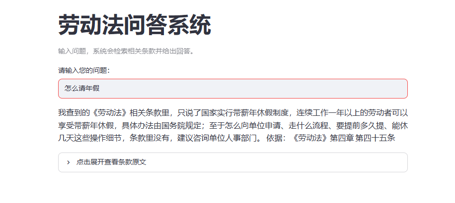

# rag-qa · 劳动权益问答助手

用大白话问打工人常碰到的劳动问题（年假、加班、试用期、劳动仲裁……），系统会先从法条中检索出最相关的条款，再让大模型**只根据这些条款**作答，并标出依据的是哪部法的哪一条。

收录三部法规，共 215 条：《中华人民共和国劳动法》（107 条）、《中华人民共和国劳动合同法》（98 条）、《职工带薪年休假条例》（10 条）。

> A retrieval-augmented QA app over three PRC labor statutes (215 articles): Chinese embeddings + Chroma for retrieval, an LLM constrained to answer only from the retrieved articles with law-and-article citations, evaluated with Recall@k.



## 它是怎么工作的

```
用户提问 "怎么请年假？"
   │
   ├─ ① 检索：问题转成向量（中文 embedding 模型）→ 在 Chroma 里按余弦相似度找出最相近的 8 条法条（三部法在同一个库里一起搜）
   │
   ├─ ② 拼 prompt：每条法条贴上「法名 + 章 + 节 + 条号」标签，加上回答规则
   │       · 只根据给出的条款回答，不使用模型自己的知识
   │       · 条款只能回答一部分时，说出能回答的，也说出没写到的
   │       · 完全不相关时，明确说没有找到
   │
   └─ ③ 生成：调用 DeepSeek 生成口语化的回答，最后一行写出依据（如"依据：《职工带薪年休假条例》第三条"）
```

离线准备（只做一次）：三份 PDF → 清洗页码 → 按"条"切成 215 块（每块带法名、章、节、条号）→ 向量化后存入 Chroma。

## 效果

### 1. 中文 embedding 模型 vs 默认英文模型

（只收录《劳动法》时测的）同一个问题"怎么请年假？"，正确答案是第四十五条（带薪年休假）：

| embedding 模型 | 第四十五条排名 | 前几名是什么 |
|---|---|---|
| Chroma 默认（all-MiniLM-L6-v2，英文） | 第 7 / 107 | 前 3 名都是第七章"女职工特殊保护"（产假相关） |
| text2vec-base-chinese（本项目） | **第 3 / 107** | 前 5 名都是休息休假相关条款 |

英文模型排出的结果更像是在匹配相同的汉字（"年**假**" / "产**假**"），中文模型才是在匹配意思。

### 2. 检索召回率 Recall@k：加了文档，k 要重新定

5 个问题（年假、劳动仲裁及时限、每日工作时长、试用期、加班费），每题人工标注"直接回答了这个问题"的条款。

| k | 1 | 2 | 3 | 4 | 5 | 6 | 7 | 8 |
|---|---|---|---|---|---|---|---|---|
| 只有《劳动法》（107 条，7 条标准答案） | 2/7 | 3/7 | 6/7 | **7/7** | 7/7 | 7/7 | 7/7 | 7/7 |
| 三部法（215 条，11 条标准答案） | 2/11 | 4/11 | 7/11 | 7/11 | 7/11 | 8/11 | 9/11 | **11/11** |

只有《劳动法》时 k=4 召回率就到顶，当时取 k=5。加入另外两部法以后，k=5 只剩 7/11，要到 **k=8** 才全部找到，所以现在默认取 k=8。

最能说明问题的是"加班费怎么算？"：题目和标准答案（劳动法第四十四条）都没变，以前 k=4 就能找到，现在要 k=6。库里的条款多了一倍，《劳动合同法》里也有不少讲加班和工资报酬的条款，把它挤到了后面。**文档越多，同一个 k 召回得越少，每加一批数据都要重新测 k。**

### 3. 加不加检索

| | "年假有几天？"的回答 |
|---|---|
| 不给条款，直接问模型 | 给出"满 1 年 5 天、满 10 年 10 天、满 20 年 15 天"，但给不出出处，用户没法核对 |
| 只收录《劳动法》时 | 只能说明第四十五条的规定（连续工作一年以上享受带薪年休假，具体办法由国务院规定），并指出天数在查到的条款里没有写明 |
| 现在（三部法） | 答出 5 / 10 / 15 天，以及哪些情况不享受当年年假，依据《职工带薪年休假条例》第三条、第四条，用户可以展开原文核对 |

## 几个设计决定

- **按"条"切块**：法条是最小的完整语义单位。固定字数切分会把一条拦腰截断，按章切分又会把多条不相关的内容混在一起稀释语义。每部法都有切块验收：条数（107 / 98 / 10）、首末条、指定条款所属的章，以及抽查正文内容（如劳动法第四十四条要包含"百分之三百"）。
- **三部法放在一个库里**：用户的问题可能落在任何一部法里，一次检索就能把几部法的条款放在一起排名，回答里也可以同时引用多部法。
- **id 带法名**（如 `劳动合同法_第五十一条`）：三部法都有"第一条"，只用条号作 id 会重复。
- **法名、章、节、条号分别存成 metadata 字段**，不拼成一个字段：拼标签时再组合；以后要"只在某部法里搜"，可以直接按字段过滤。《年休假条例》没有章节，对应字段存空字符串，拼标签时跳过。
- **余弦距离**：Chroma 默认是 L2（欧氏距离），会偏向长度短的文本块；这里显式改为余弦。
- **每次重建索引都删表重建**：`add()` 遇到已存在的 id 会静默跳过，`upsert()` 删不掉已不存在的块，所以选择整表重建。
- **说话的范围不超过检索到的范围**：回答里说"我查到的相关条款里没有写"，而不是"法律里没有规定"，因为模型只看到了检索出的几条。
- **网页上的条款原文直接取自检索结果**，而不是从模型的回答里解析，用户可以展开核对。
- **`max_tokens` 设为 5000**：模型回答前会先"思考"，思考用的 token 也计入上限，而且同一个问题每次思考的长度不同。设为 2000 时，测试中同一个问题时而成功、时而被截断。上限只是封顶，按实际用量计费，调高不会多花钱。

## 技术栈

| 组件 | 用途 |
|---|---|
| pypdf | 从 PDF 中读取文字 |
| text2vec + torch | 把中文文本转成向量（shibing624/text2vec-base-chinese） |
| chromadb | 向量存储与检索 |
| openai + python-dotenv | 调用 DeepSeek（OpenAI 兼容接口），API Key 从 `.env` 读取 |
| streamlit | 网页界面 |

## 快速开始（Windows PowerShell）

1. 下载仓库并进入文件夹
   ```
   git clone https://github.com/y15154520-cmd/rag-qa.git
   cd rag-qa
   ```
2. 建立虚拟环境。文件夹名必须是 `.venv`，因为 `.gitignore` 只忽略这个名字，换别的名字会被提交进仓库
   ```
   python -m venv .venv
   .\.venv\Scripts\Activate.ps1
   ```
3. 安装依赖。首次安装和首次运行合计需要下载 1 GB 以上（torch 与中文 embedding 模型，模型从 HuggingFace 下载）
   ```
   pip install -r requirements.txt
   ```
4. 配置 API Key：复制模板，再在 `.env` 里填入自己的 DeepSeek API Key
   ```
   Copy-Item .env.example .env
   ```
5. 建立索引（只需做一次，会生成 `chroma_db/` 文件夹，里面是三部法的 215 条）
   ```
   python build_index.py
   ```
6. 启动网页
   ```
   streamlit run app.py
   ```

其他命令：
- 命令行问答：`python answer.py`
- 检索评测：`python eval_retrieval.py`
- 切块验收：`python ingest.py`

## 文件结构

| 文件 | 作用 |
|---|---|
| `data/labor_law.pdf` | 《中华人民共和国劳动法》（2018 年修正），来自国家法律法规数据库 |
| `data/labor_contract_law.pdf` | 《中华人民共和国劳动合同法》（2012 年修正），来源同上 |
| `data/paid_annual_leave.pdf` | 《职工带薪年休假条例》（2007 年），来源同上 |
| `ingest.py` | 读取 PDF、清洗页码、按条切块，附切块验收 |
| `build_index.py` | 三部法切块合并，向量化后存入 Chroma |
| `answer.py` | 检索、拼标签和 prompt、命令行问答 |
| `llm.py` | 大模型调用的适配层（缺少 Key 时直接给出明确报错） |
| `app.py` | Streamlit 网页 |
| `eval_retrieval.py` | Recall@k 检索评测 |
| `precommit_check.py` | 提交前检查 `.env` 是否被忽略 |

## 已知局限

- 只收录了三部法规。《劳动争议调解仲裁法》《工伤保险条例》等尚未收录，相关问题只能回答"没有查到"。
- 评测集只有 5 个问题、11 条标准答案，k=8 是在这个小样本上定的，需要更大的评测集来确认。
- 用户用词和法条用词差距大时（如"加班费"与"延长工作时间的工资报酬"），检索仍可能排名靠后；可以尝试先改写问题再检索。
- 回答质量目前靠人工检查，还没有自动化评估。
- 本项目仅用于学习，回答不构成法律意见。
